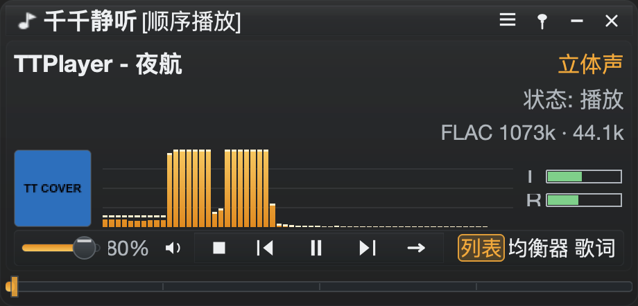
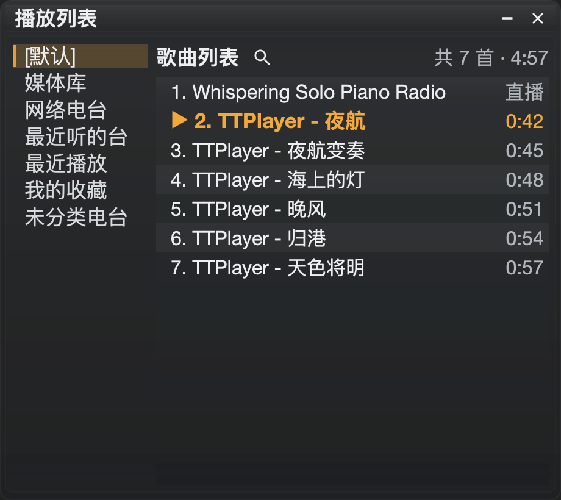
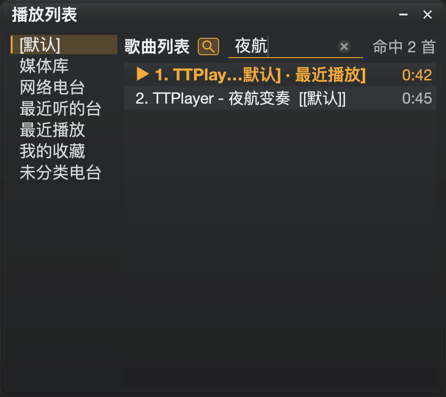
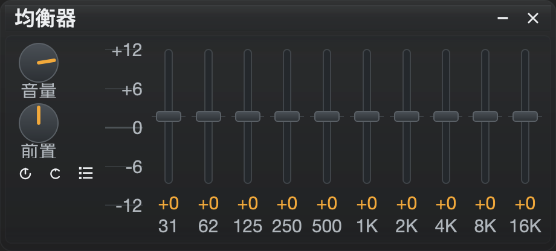

# TTPlayer（千千静听复刻版）

TTPlayer 是一款 Qt 桌面音乐播放器，沿用经典千千静听的独立面板布局。主面板、播放列表、均衡器和歌词窗共用一套深色玻璃皮肤，面向 macOS、Windows 和 Linux。

## 功能

- **本地与归档播放**　音频文件、文件夹、CUE 整轨、M3U 列表、ZIP / TAR / 7z 压缩包都能直接播放，归档内的音频不落地解压；媒体库可跟踪磁盘目录并自动重扫。
- **网络电台**　直播流、ICY 曲名、自定义台名与电台分类。起播先积累约 2 秒音频，播放中最多缓冲 12 秒，断流按退避重连，台站属性里有欠载与重连统计。
- **全局搜索**　按标题、艺术家、专辑和文件名搜索整个播放器，命中条目附带来源，退出搜索即回到原列表与选区。
- **播放队列**　支持「下一首播放」与「稍后播放」，队列独立于当前浏览的列表，切换页面或搜索都不影响。
- **无缝播放与响度**　同一专辑的曲目在输出侧直接衔接；ReplayGain 支持曲目与专辑两种口径，并提供前置增益和峰值防削波。
- **十段均衡器**　逐段调整或套用预设。
- **歌词与封面**　读取同名 LRC 逐行高亮，可按曲校准时间；封面取内嵌图片或同目录图片，主面板显示缩略图，也能打开大图窗。
- **格式转换**　输出 AAC、ALAC、FLAC 或 WAV，可定码率、压缩档、采样率、声道与音量；结果另存新文件，同名自动加序号。
- **输出与外观**　可跟随系统默认输出或指定设备，睡眠定时器支持倒计时停止或播完当前曲目停止，各面板玻璃透明度可调。
- **现场恢复与后台播放**　重开播放器能接回上次的队列与位置；隐藏整组窗口后音乐继续播放，可从托盘或菜单栏图标恢复。

## 界面

| 播放列表 | 全局搜索 |
| --- | --- |
|  |  |

| 网络电台 | 待播队列 |
| --- | --- |
|  |  |

| 十段均衡器 | 同步歌词 | 专辑封面 |
| --- | --- | --- |
|  |  |  |

## 文件格式

| 类别 | 格式 |
| --- | --- |
| 有损音频 | MP3、AAC、Vorbis、Opus、WMA |
| 无损与高解析音频 | FLAC、Apple Lossless（ALAC）、WavPack、TTA、APE、PCM WAV、AIFF，以及解码为 PCM 输出的 DSF / DFF |
| 整轨与列表 | CUE 分轨、M3U / M3U8 列表导入与导出 |
| 归档直听 | ZIP、TAR（含 gzip / bzip2）、7z。直接从归档读取音频，具体格式取决于所用 libarchive |

## 快捷键

macOS 使用 `⌘`，Windows 和 Linux 使用 `Ctrl`；Mac 键盘将功能键用于亮度或音量时需配合 `Fn`。

| 操作 | 快捷键 |
| --- | --- |
| 播放 / 暂停，静音 | `空格`，`M` |
| 上一首 / 下一首 | `←` / `→` |
| 顺序、单曲循环、列表循环、随机 | `F1`、`F2`、`F3`、`F4` |
| 打开文件 / 添加文件夹 | `⌘/Ctrl + O` / `⌘/Ctrl + Shift + O` |
| 全局搜索 / 收藏当前曲目 | `⌘/Ctrl + F` / `⌘/Ctrl + D` |
| 显隐播放列表 / 均衡器 / 歌词 | `⌘/Ctrl + 1` / `⌘/Ctrl + E` / `⌘/Ctrl + L` |
| 歌词偏移 −0.5 秒 / +0.5 秒，归零 | `Alt/⌥ + ←` / `Alt/⌥ + →`，`Alt/⌥ + 0` |

## 获取与反馈

本页截图来自 macOS 上实际运行的 Qt 版，macOS 部署目标为 12.0。此轮更新尚未发布安装包；下载已有版本时请核对发布说明中的实现、平台和处理器架构。[历史发布](https://github.com/myzhan/TTPlayer/releases) · [Qt 源码构建与运行](AGENTS.md#构建) · [反馈问题](https://github.com/myzhan/TTPlayer/issues)

项目代码使用 MIT 许可证，FFmpeg 等第三方组件遵循各自的许可证。[项目许可证](LICENSE)
