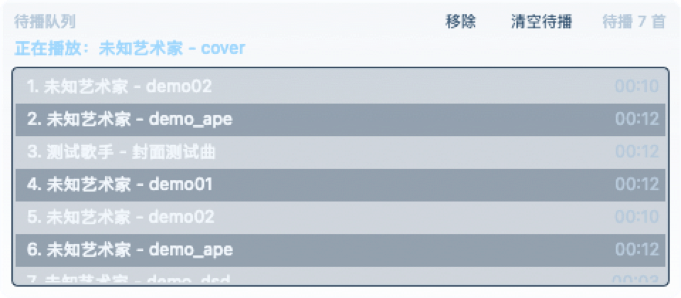
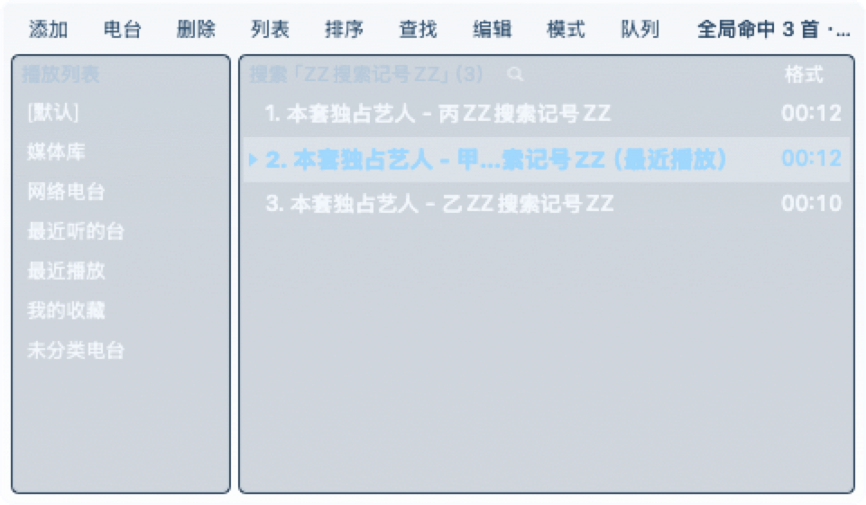
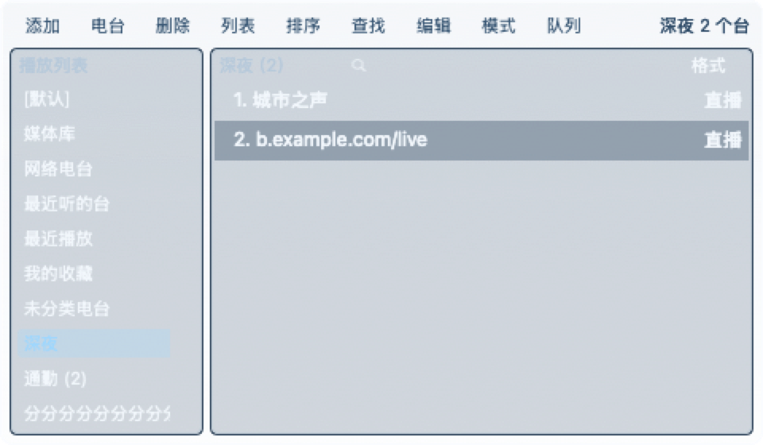

# TTPlayer（千千静听 macOS 复刻版）

一款 macOS 原生桌面音频播放器，向经典 TTPlayer 千千静听的皮肤与交互致敬。设计目标为**低资源占用 · 视觉品质 · 广泛格式支持**。

## 主要特性

- **格式覆盖广**：MP3 · AAC/M4A · FLAC · Apple Lossless · OGG（Vorbis/Opus）· APE · TTA · WAV/AIFF/CAF/AU/W64 等 PCM · DSF（DSD64/128/…）· Matroska 音频轨 · CUE 分轨 · 网络电台 · zip/tar/7z/rar 压缩包直听
- **听得干净**：无缝播放（专辑曲间不插空白）· ReplayGain 响度均衡（按曲目 / 按专辑，带峰值防削波与前置增益）· 10 段均衡器 + 8 组预设
- **管得住曲库**：媒体库目录自动跟踪（盘上有增删不必手动重扫）· 自建歌单与 m3u 导入导出 · 全局搜索 · 待播队列 · 收藏与两份最近播放历史 · 退出时的现场下次原样回来
- **电台齐活**：出厂自带一台电台（装上就在列表里，不想要直接删）· 自定义台名 · 分类管理 · 改地址搬家 · ICY「正在播放」· 断线按退避自动重连 · 连接质量统计
- **单文件分发**：通用二进制（Universal 2，同时支持 Intel 与 Apple Silicon），zip 下载 ≈ 6 MB / 解压后 app ≈ 13 MB
- **低资源占用**：播放态 CPU 与 QQ 音乐同量级（6~8%）；窗口被遮挡或熄屏时自动暂停绘图
- **可调半透明皮肤**：壳层、内嵌槽、按钮、传输带、底部条共用单一透明度参数，菜单里滑块实时调节
- **快捷键**：`空格` 播放/暂停 · `←` / `→` 上下曲 · `F1`~`F4` 四种播放方式 · `⌘O` 添加 · `⌘F` 搜索 · `⌘D` 收藏 · `⌘1` / `⌘E` / `⌘L` 列表 / 均衡器 / 歌词秀 · `⌥←` / `⌥→` / `⌥0` 歌词校准 · `⌘Q` 退出
- **系统整合**：菜单栏驻留后台继续播放 · 控制中心 / 锁屏 Now Playing · 输出设备任选 · 睡眠定时器

## 界面

> 以下截图由自检渲染生成，背景固定；实际运行时壳层/内嵌槽/按钮按透明度参数与桌面壁纸实时合成。

**主面板**（标题条：图标 + 程序名 + 播放方式徽章 + 菜单 / 置顶 / 最小化 / 关闭；显示区：封面格 + 曲目信息与 64 柱频谱 + 采样率与状态；底部：进度条、走带键、音量与「列表 / 均衡器 / 歌词」）


| 播放列表（左栏分组页 · 工具条九键） | 待播队列 |
| :-: | :-: |
|  |  |

| 全局搜索（命中行末标来源页） | 电台分类页 |
| :-: | :-: |
|  |  |

| 均衡器 | 歌词秀 |
| :-: | :-: |
|  |  |

**大封面窗**（点显示区那一格封面就是它）


## 安装

### 通过 GitHub Release 安装（推荐）

从 [Releases 页面](https://github.com/myzhan/TTPlayer/releases) 下载最新版本 `TTPlayer-vX.Y.Z-macOS-universal.zip`：

```sh
unzip TTPlayer-vX.Y.Z-macOS-universal.zip
mv TTPlayer.app ~/Applications/
xattr -dr com.apple.quarantine ~/Applications/TTPlayer.app
open ~/Applications/TTPlayer.app
```

发布包采用 ad-hoc 签名，未经 Apple 公证。首次启动需通过上述 `xattr` 命令移除隔离属性，或在 Finder 中右键图标选择"打开"。

### 从源码构建

前置条件：macOS 12+、Xcode 15+ 命令行工具、`brew install nasm yasm`。

```sh
git clone --recurse-submodules https://github.com/myzhan/TTPlayer.git
cd TTPlayer
zsh build_app.sh
open build/TTPlayer.app
```

`build_app.sh` 会先调用 `scripts/build_ffmpeg.sh` 从 submodule 编译 FFmpeg 静态库（首次约需 5 分钟），随后打包 `.app`。开发流程详见 [`AGENTS.md`](AGENTS.md)。

## 支持格式

| 类别 | 范围 |
| --- | --- |
| 有损编码 | MP3（含 MP2/M2A/MPA）· AAC / ADTS（含 HE-AAC）· Vorbis / Opus（`.ogg`）|
| 无损编码 | WAV / AIFF / CAF / AU / W64 里的 PCM（8/16/24/32-bit、float、μ-law/A-law、IMA ADPCM）· FLAC · ALAC · APE（`.ape/.apl/.mac`）· TTA |
| Hi-Res / DSD | 24 / 32-bit PCM · DSF（DSD64 / 128 / …，解出后降 8 倍到 PCM 基准率）|
| 容器 | m4a / mp4 / m4b · mov（拖单文件时试其音轨，目录扫描不收）· mkv / mka / mks / webm · caf · au / snd · w64 |
| 网络流 | HTTP / HTTPS 直播流（ICY metadata）|
| 分轨与歌单 | CUE sheet（内嵌或外挂）· m3u / m3u8 |
| 归档容器 | zip · tar · tar.gz · tar.bz2 · 7z · rar（拖入压缩包直接听，无需先解压）|
| 标签与封面 | ID3v1 / v2 · Vorbis Comment · MP4 ilst · APEv2 · FLAC PICTURE · M4A 内嵌封面 |

白名单以运行时枚举内置 FFmpeg 解复用器声明的扩展名为准（当前可播放 41 个后缀），不在表里的后缀会在导入时给一句拒收原因。同专辑曲目共用一份封面位图；小档 112 px 常驻，大档 256 px 按需解码并纳入 LRU 缓存。已知限制与逐项实测见 [Releases](https://github.com/myzhan/TTPlayer/releases)。

## 系统要求

- macOS 12 Monterey 或更新版本（Intel 与 Apple Silicon 均支持）
- 磁盘空间：zip 下载 ≈ 6 MB，解压后 app ≈ 13 MB（arm64 + x86_64 两个架构同时包含）

## 常见问题

**首次启动提示"已损坏，无法打开"**
ad-hoc 签名的 app 未经 Apple 公证，Gatekeeper 会阻止打开。执行 `xattr -dr com.apple.quarantine /path/to/TTPlayer.app`，或在 Finder 中右键图标选择"打开"。

**如何终止进程**
`⌘Q`；或点击菜单栏图标选择"退出"；或点击主面板 `×`。本项目的 `×` 语义为终止进程（不同于 macOS 常规窗口关闭），后台驻留请使用 `—`。

**皮肤未呈现透明效果**
确认菜单中"半透明玻璃"已勾选，并将下方"透明度"滑块向左调整。若桌面壁纸为纯黑或纯色低对比图像，视觉差异不明显。

**F1~F4 按了没反应**
Mac 键盘默认把功能键分配给亮度 / 播放控制。请在系统设置 → 键盘中启用"将 F1、F2 等键用作标准功能键"，或按住 `Fn` 再按；菜单里也有同样的四种播放方式。

**某些文件拖进来没反应**
播放器按后缀白名单放行。本 build 的 FFmpeg 未编入解码器的（`.tak`、Musepack、Shorten、RealAudio、MIDI / Tracker 模块）会给出具体原因；另有少数容器 FFmpeg 其实能解、但解复用器没声明后缀（如 `.wv`、`.aifc`、`.dff`、`.opus`、`.wma`），目前需要你先转成 FLAC / ALAC 再入库。

**DSD 文件无声或异常**
`.dsf` 由 FFmpeg 解出 DSD 流后再降采样 8 倍到 PCM 基准率（DSD64 → 44.1 kHz、DSD128 → 88.2 kHz）。若音频设备不支持高采样率，请把输出设备切到 44.1 kHz 或 48 kHz 那一档，或在菜单 → 输出设备里固定到别的设备。

**媒体库和 `[默认]` 列表有什么区别？**
「媒体库」是目录扫描出来的只读视图：盘上有什么就是什么，不能删行也不能清空，想少收一片目录去菜单 → 媒体库里移除。`[默认]` 才是你自己攒的播放列表，导入、拖入、排序、清空都作用于它。

**响度均衡为什么默认关闭？**
它会把不同母带的相对响度拉平，属于"改掉原曲听感"的处理，因此不像无缝播放那样默认开启。需要时按曲目或按专辑打开，没有 ReplayGain 标签的曲子仍保持原音量。

## 许可

[MIT](LICENSE)。本项目代码按 MIT 开源；FFmpeg 组件遵循其自身 LGPL/GPL 许可，从源码静态编译链入仅供个人使用，若需再分发请自行核对 FFmpeg 授权条款。

## 相关

- 开发约定与贡献指南（环境 / 命令 / 分层 / 常见坑 / 验证）：[`AGENTS.md`](AGENTS.md)；每版实测数据与安装包见 [Releases](https://github.com/myzhan/TTPlayer/releases)
- Issue 与建议：<https://github.com/myzhan/TTPlayer/issues>
