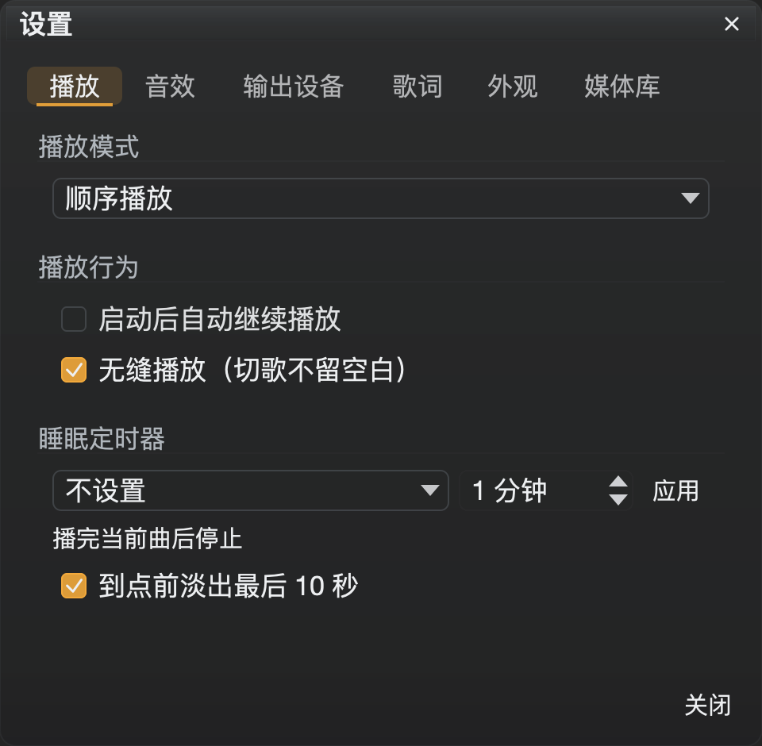
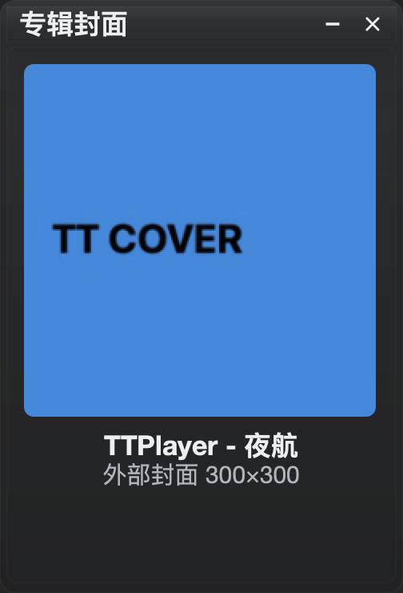

# TTPlayer（千千静听复刻版）

TTPlayer 是一款 Qt 桌面音乐播放器，沿用经典千千静听的独立面板布局，面向 macOS、Windows 和 Linux。主面板、播放列表、均衡器、歌词，以及设置、媒体文件信息和专辑封面窗共用深色玻璃皮肤。

## 功能

- **本地与归档播放**　音频文件、文件夹、CUE 整轨、M3U 列表、ZIP / TAR / 7z 压缩包都能直接播放，归档内的音频不落地解压；媒体库可跟踪磁盘目录并自动重扫；拒收文件的完整路径与原因可在「设置 → 媒体库」查看、滚动和复制。
- **网络电台**　直播流、ICY 曲名、自定义台名与电台分类。起播先积累约 2 秒音频，播放中最多缓冲 12 秒，断流按退避重连，台站属性里有欠载与重连统计。
- **全局搜索**　按标题、艺术家、专辑和文件名搜索整个播放器，命中条目附带来源，退出搜索即回到原列表与选区。
- **列表与收藏**　列表管理在左栏右键菜单，曲目右键提供文件、属性、转换等操作；点击时长左侧的爱心即可收藏。列表总时长按 `HH:MM:SS` 显示，不计电台时长。浏览其他列表或搜索不打断当前播放。
- **无缝播放与响度**　同一专辑的曲目在输出侧直接衔接；ReplayGain 支持曲目与专辑两种口径，并提供前置增益和峰值防削波。
- **十段均衡器**　逐段调整或套用预设。
- **内嵌与外置歌词**　优先读取音频内嵌歌词，没有有效正文时再找外置 LRC。有时间标签的歌词逐行高亮并可按曲校准；纯文本歌词支持滚动、选择和复制。
- **专辑封面**　读取内嵌图片或同目录图片，主面板显示缩略图，也能打开独立大图窗。
- **格式转换**　普通本地音频可转换为 AAC、MP3、OGG Vorbis、Opus、ALAC、FLAC 或 WAV；按格式调整码率、压缩档、采样率、声道与音量，结果另存新文件，同名自动加序号。
- **输出与外观**　可跟随系统默认输出或指定设备，睡眠定时器支持倒计时停止或播完当前曲目停止，玻璃透明度可调。主面板右上角直接打开设置；设置、文件信息和封面窗可吸附跟随主面板，也可拖离独立摆放。
- **现场恢复与后台播放**　首次启动显示主面板和列表，之后保留自己的面板显隐选择；重开能接回上次的播放曲目、列表和位置。主面板「×」退出，「—」隐藏整组并继续播放，可从托盘或菜单栏图标恢复；无托盘时保留最小化恢复入口。

## 界面

| 播放列表 | 全局搜索 |
| --- | --- |
|  |  |

| 网络电台 | 设置 |
| --- | --- |
|  |  |

| 内嵌同步歌词 | 内嵌纯文本歌词 |
| --- | --- |
|  |  |

| 十段均衡器 | 专辑封面 |
| --- | --- |
|  |  |

## 文件格式

| 类别 | 格式 |
| --- | --- |
| 有损音频 | MP1 / MP2 / MP3、AAC、Vorbis、Opus、WMA / WMA Pro / WMA Voice、Musepack SV7 / SV8、AMR-NB / AMR-WB |
| 无损与高解析音频 | FLAC、Apple Lossless（ALAC）、WavPack、TTA、APE、TAK、Shorten（SHN）、WMA Lossless、PCM WAV / AIFF / CAF / AU / Wave64，以及解码为 PCM 输出的 DSF / DFF |
| 独立音轨 | AC-3 / E-AC-3、DTS / DTS-HD、MLP / TrueHD；也可读取受支持容器中的相应音频流 |
| MIDI 与模块音乐 | MID / MIDI / KAR（SMF 0/1，含 RMID 包装）、MOD / XM / S3M / IT；内置默认 GM 音色，无需配置即可播放、定位或转换为普通音频 |
| 整轨与列表 | CUE 分轨、M3U / M3U8 列表导入与导出 |
| 归档直听 | ZIP、TAR（含 gzip / bzip2）、7z。直接从归档读取音频，具体格式取决于所用 libarchive |
| 歌词 | MP3 USLT、常见 `lyrics` 元数据中的 LRC 或纯文本，以及外置 LRC；暂不解析 MP3 SYLT 二进制同步帧 |

普通音频使用 FFmpeg 解码；MIDI 与模块音乐按需合成为 PCM，不增加转换输出种类。MP2、DTS Core、AC-3、E-AC-3、MLP、TrueHD 与 AMR-NB 已用现场生成音频验证；WMA Pro / Lossless / Voice、DTS-HD、Musepack、TAK、Shorten、MP1 与 AMR-WB 暂仅核对组件注册，尚缺实际音频样本覆盖。是否可播仍取决于文件里的具体码流；不支持 DRM 加密文件或原生 DSD 输出。MIDI 不支持格式 2、MT-32 等专用音源；不保证专有 GS/XG 音色还原。KAR 优先显示内嵌歌词。长 MIDI 冷定位需要重放前段，位置越靠后等待可能越长；不提供 MIDI 编辑、导出或音色选择。

## 快捷键

macOS 使用 `⌘`，Windows 和 Linux 使用 `Ctrl`；Mac 键盘将功能键用于亮度或音量时需配合 `Fn`。

| 操作 | 快捷键 |
| --- | --- |
| 播放 / 暂停，静音 | `空格`，`M` |
| 上一首 / 下一首 | `←` / `→` |
| 顺序、单曲循环、列表循环、随机 | `F1`、`F2`、`F3`、`F4` |
| 打开文件 / 添加文件夹 | `⌘/Ctrl + O` / `⌘/Ctrl + Shift + O` |
| 全局搜索 / 收藏当前曲目 | `⌘/Ctrl + F` / `⌘/Ctrl + D` |
| 显隐播放列表 / 均衡器 / 歌词 | `⌘/Ctrl + 1` / `⌘/Ctrl + E` / `⌘/Ctrl + L` |
| 歌词偏移 −0.5 秒 / +0.5 秒，归零 | `Alt/⌥ + ←` / `Alt/⌥ + →`，`Alt/⌥ + 0` |

## 获取与反馈

本页截图来自 macOS 上实际运行的当前 Qt 版，macOS 部署目标为 12.0。Windows 版为绿色目录布局：程序与存档在同一目录，请解压到可写文件夹，整目录可搬迁。Linux 发布配置提供 x86_64 与 arm64 两种 AppImage：x86_64 要求 glibc 2.35+（如 Ubuntu 22.04+），arm64 要求 glibc 2.39+（如 Ubuntu 24.04+）；Qt 与插件随包内置，下载后赋予执行权限即可运行。此轮更新尚未发布安装包；下载已有版本时请核对发布说明中的功能、平台和处理器架构。[历史发布](https://github.com/myzhan/TTPlayer/releases) · [Qt 源码构建与运行](AGENTS.md#构建) · [反馈问题](https://github.com/myzhan/TTPlayer/issues)

项目代码使用 MIT 许可证，FFmpeg 等第三方组件遵循各自的许可证。[项目许可证](LICENSE)
