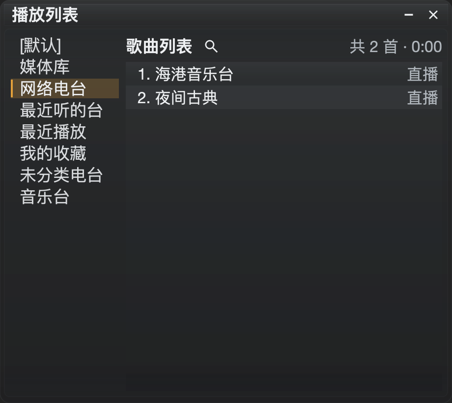
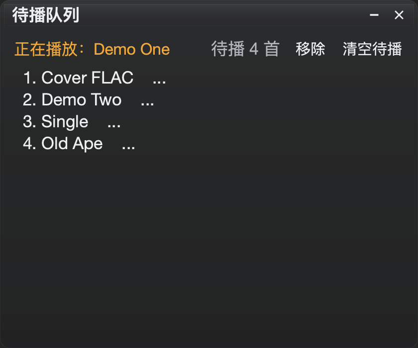

# TTPlayer（千千静听复刻版）

TTPlayer 是一款 Qt 桌面音乐播放器，保留了经典千千静听的独立面板操作。可以拖入本地音乐、整张专辑的 CUE 或压缩包，也可以收藏网络电台。主面板、播放列表、均衡器和歌词窗都使用深色皮肤。

## 开始听歌

- **打开音乐**　把音频文件、文件夹、CUE 或歌单拖进主窗，或点打开文件按钮。手动导入的曲目保存在「默认」列表。要持续跟踪磁盘目录，在媒体库中添加文件夹，目录内容变化后会自动重扫。
- **转换格式**　在列表里选中曲目（可多选）点右键，选「转换为其他格式…」。可输出 AAC、ALAC、FLAC 或 WAV，并自定码率、压缩档、采样率、声道与音量；结果另存为新文件，同名时自动加序号，绝不覆盖原文件。
- **安排下一首**　在曲目菜单选「下一首播放」或「稍后播放」，再打开「队列」查看和调整顺序。浏览其他歌单或搜索时，当前播放队列会保留。
- **找回一首歌**　点列表上方的放大镜，输入歌名或歌手名，全局结果会附上来源。按 `Esc` 可回到搜索前的列表和选区。
- **恢复现场**　重新打开播放器可以接回上次的队列和位置。要在启动后接着播放，请在设置中勾选「启动后自动继续播放」。
- **后台收听**　点主窗的 `—` 隐藏整组窗口，音乐继续播放，通过托盘或菜单栏图标可恢复窗口。没有系统托盘时可通过最小化窗口恢复。点主窗的 `×` 退出播放器。

| 播放列表 | 全局搜索 |
| --- | --- |
|  |  |

## 网络电台

点播放列表工具栏的「电台」，粘贴 HTTP 或 HTTPS 直播地址。可以给台站改名、修改地址，也可以在左栏「网络电台」上点右键建立分类。支持 ICY 的台站会显示正在播放的曲名。连接中断后播放器会退避重连，达到重试上限后可手动重试。

起播时会先积累约 **2 秒**音频，播放中的缓冲最多可容纳 **12 秒**解码音频。若网络中断到缓冲耗尽，会等缓冲补足后再出声。在台站的「属性」中可以查看当前缓冲秒数，以及最近 30 秒和本次收听累计的欠载、重连次数。

| 网络电台 | 待播队列 |
| --- | --- |
|  |  |

## 音效、歌词与封面

无缝播放用于连续收听整张专辑。ReplayGain 可按曲目或专辑调整响度，并提供前置增益与峰值防削波。十段均衡器可以独立调整或使用预设。歌词窗读取 LRC，支持按曲校准时间。点击主面板的小封面可查看专辑大图。

| 十段均衡器 | 同步歌词 | 专辑封面 |
| --- | --- | --- |
|  |  |  |

## 常用设置

从主面板菜单打开「设置」。在「输出设备」中可以跟随系统默认设备，或指定耳机、声卡，并查看当前实际输出。「播放」中的睡眠定时器可以倒计时停止，也可以播完当前曲目再停。「外观」可调各面板共用的玻璃透明度。

## 文件格式

| 类别 | 格式 |
| --- | --- |
| 有损音频 | MP3、AAC、Vorbis、Opus、WMA |
| 无损与高解析音频 | FLAC、Apple Lossless（ALAC）、WavPack、TTA、APE、PCM WAV、AIFF，以及解码为 PCM 输出的 DSF / DFF |
| 整轨与歌单 | CUE 分轨、M3U / M3U8 歌单导入与导出 |
| 归档直听 | ZIP、TAR（含 gzip / bzip2）、7z。直接从归档读取音频，具体格式取决于所用 libarchive |

## 快捷键

下表中的组合键在 macOS 使用 `⌘`，Windows 和 Linux 使用 `Ctrl`。Mac 键盘如果将功能键用于亮度或系统音量，可配合 `Fn` 使用。

| 操作 | 快捷键 |
| --- | --- |
| 播放 / 暂停，静音 | `空格`，`M` |
| 上一首 / 下一首 | `←` / `→` |
| 顺序、单曲循环、列表循环、随机 | `F1`、`F2`、`F3`、`F4` |
| 打开文件 / 添加文件夹 | `⌘/Ctrl + O` / `⌘/Ctrl + Shift + O` |
| 全局搜索 / 收藏当前曲目 | `⌘/Ctrl + F` / `⌘/Ctrl + D` |
| 显隐播放列表 / 均衡器 / 歌词 | `⌘/Ctrl + 1` / `⌘/Ctrl + E` / `⌘/Ctrl + L` |
| 歌词偏移 −0.5 秒 / +0.5 秒，归零 | `Alt/⌥ + ←` / `Alt/⌥ + →`，`Alt/⌥ + 0` |

## 获取与反馈

本页截图来自 macOS 上实际运行的 Qt 版。Qt 版面向 macOS、Windows 和 Linux，macOS 部署目标为 12.0。此轮更新尚未发布安装包。下载已有版本时，请核对发布说明中的实现、平台和处理器架构。[历史发布](https://github.com/myzhan/TTPlayer/releases) · [Qt 源码构建与运行](AGENTS.md#构建) · [反馈问题](https://github.com/myzhan/TTPlayer/issues)

项目代码使用 MIT 许可证，FFmpeg 等第三方组件遵循各自的许可证。[项目许可证](LICENSE)
