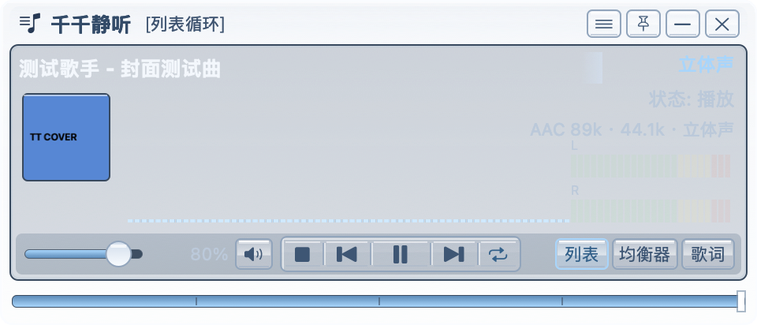
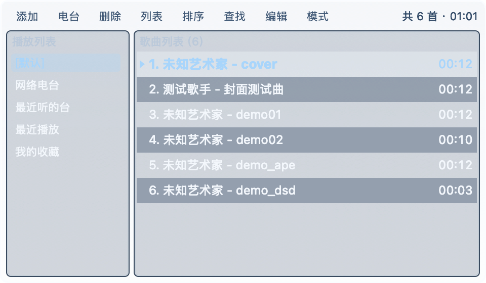
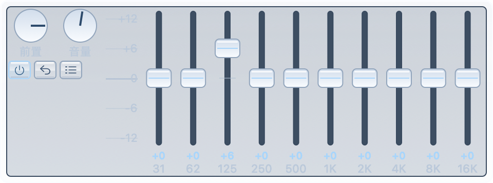
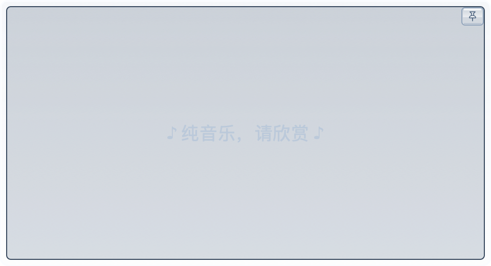

# 千千静听 macOS 复刻版（TTPlayer）

一款 macOS 原生桌面音频播放器，向经典 [TTPlayer 千千静听](https://myzhan.github.io) 的皮肤与交互致敬。设计目标为**低资源占用 · 视觉品质 · 广泛格式支持**。

## 主要特性

- **格式覆盖广**：mp3、flac、ape、tta、wv、DSD、24/32-bit hi-res、网络电台、CUE 分轨、zip/tar/7z/rar 压缩包直听等，白名单收录 43 个扩展名
- **单文件分发**：app 包 4.5 MB，通用二进制（Universal 2，同时支持 Intel 与 Apple Silicon）
- **低资源占用**：播放态 CPU 与 QQ 音乐同量级（6~8%）；窗口被遮挡或熄屏时自动暂停绘图
- **可调半透明皮肤**：壳层、内嵌槽、按钮、传输带、底部条共用单一透明度参数，右键菜单内置滑块实时调节
- **菜单栏驻留**：支持最小化至后台继续播放；集成 macOS 控制中心、锁屏与 Now Playing

## 界面

> 以下截图由自检渲染生成，背景固定；实际运行时壳层/内嵌槽/按钮按透明度参数与桌面壁纸实时合成。

**主面板**（标题栏 + 显示区：封面格 / 64 柱频谱 / 底部一列传输键、音量与"列表 / 均衡器 / 歌词"文字键）



| 播放列表 | 均衡器 |
| :-: | :-: |
|  |  |

| 歌词秀 | 大封面窗 |
| :-: | :-: |
|  |  |

## 安装

### 通过 GitHub Release 安装（推荐）

从 [Releases 页面](https://github.com/myzhan/TTPlayer/releases) 下载最新版本 `TTPlayer-vX.Y.Z-macOS-universal.zip`：

```sh
unzip TTPlayer-vX.Y.Z-macOS-universal.zip
mv TTPlayer.app ~/Applications/
xattr -dr com.apple.quarantine ~/Applications/TTPlayer.app
open ~/Applications/TTPlayer.app
```

发布包采用 ad-hoc 签名，未经 Apple 公证。首次启动需通过上述 `xattr` 命令移除隔离属性，或在 Finder 中右键图标选择"打开"。

### 从源码构建

前置条件：macOS 12+、Xcode 15+ 命令行工具、`brew install nasm yasm`。

```sh
git clone --recurse-submodules https://github.com/myzhan/TTPlayer.git
cd TTPlayer
zsh build_app.sh
open build/TTPlayer.app
```

`build_app.sh` 会先调用 `scripts/build_ffmpeg.sh` 从 submodule 编译 FFmpeg 静态库（首次约需 5 分钟），随后打包 `.app`。开发流程详见 [`AGENTS.md`](AGENTS.md)。

## 使用说明

- **导入曲目**：右键主面板任意位置，选择"添加文件…"、"添加文件夹…"或"添加网络电台…"；亦支持将音频文件或文件夹直接拖入窗口
- **窗口控制**：`×` 终止进程；`—` 隐藏至菜单栏并保持播放（点击菜单栏图标可恢复窗口或退出）
- **半透明调节**：右键面板 → "半透明玻璃" 勾选启用，下方"透明度"滑块可实时调节，松开后写入 `state.json`
- **快捷键**：`⌘Space` 播放/暂停 · `⌘1` 播放列表 · `⌘E` 均衡器 · `⌘L` 歌词秀 · `⌘D` 收藏当前曲 · `⌘Q` 退出
- **CUE 分轨**：将 `.cue` 与整轨音频置于同一目录，导入 `.cue` 文件即可自动切分为多轨
- **压缩包直听**：将整张专辑的 `.zip` / `.tar(.gz/.bz2)` / `.7z` / `.rar` 直接拖入窗口，播放器流式读取包内音频条目并入表，无需先解压（加密条目暂不支持）
- **歌词**：与音频同名的 `.lrc` 自动挂载；亦可通过"属性"面板手动指定
- **网络电台**：支持 icy / http / https 协议，解析 ICY metadata 中的台名与当前曲名；切换电台采用淡出后换流，断线自动重连

## 支持格式

| 类别 | 范围 |
| --- | --- |
| 有损编码 | mp3 · aac / m4a · ogg · opus · flac · ape · wv · tak · wma |
| 无损编码 | wav · aiff · flac · alac · ape · tta · wv · shorten |
| Hi-Res / DSD | 24 / 32-bit PCM · DSF · DFF（一级盒式降采样至 PCM 播放）|
| 容器 | m4a · caf · au · snd · w64 · mka · mp4 · mkv（音频轨）· aifc |
| 网络流 | HTTP / HTTPS 直播流（ICY metadata）|
| 分轨 | CUE sheet（内嵌或外挂）|
| 归档容器 | zip · tar · tar.gz · tar.bz2 · 7z · rar（拖入压缩包直接听，无需先解压）|
| 标签与封面 | ID3v1 / v2 · Vorbis Comment · MP4 ilst · APEv2 · FLAC PICTURE · M4A 内嵌封面 |

同专辑曲目共用一份封面位图；小档 112 px 常驻，大档 256 px 按需解码并纳入 LRU 缓存。已知限制与逐项实测见 [Releases](https://github.com/myzhan/TTPlayer/releases)。

## 系统要求

- macOS 12 Monterey 或更新版本（Intel 与 Apple Silicon 均支持）
- 磁盘空间：解压后 app 约 4.5 MB

## 常见问题

**首次启动提示"已损坏，无法打开"**
ad-hoc 签名的 app 未经 Apple 公证，Gatekeeper 会阻止打开。执行 `xattr -dr com.apple.quarantine /path/to/TTPlayer.app`，或在 Finder 中右键图标选择"打开"。

**如何终止进程**
`⌘Q`；或点击菜单栏图标选择"退出"；或点击主面板 `×`。本项目的 `×` 语义为终止进程（不同于 macOS 常规窗口关闭），后台驻留请使用 `—`。

**皮肤未呈现透明效果**
确认右键面板中"半透明玻璃"已勾选，并将"透明度"滑块向左调整。若桌面壁纸为纯黑或纯色低对比图像，视觉差异不明显。

**DSD 文件无声或异常**
`.dsf` / `.dff` 经一级盒式降采样至 176.4 kHz PCM 输出。若音频设备不支持高采样率，请将系统声音输出切换至 44.1 kHz 或 48 kHz。

## 许可

[MIT](LICENSE)。本项目代码按 MIT 开源；FFmpeg 组件遵循其自身 LGPL/GPL 许可，从源码静态编译链入仅供个人使用，若需再分发请自行核对 FFmpeg 授权条款。

## 相关

- 开发约定与贡献指南（环境 / 命令 / 分层 / 常见坑 / 验证）：[`AGENTS.md`](AGENTS.md)；每版实测数据与安装包见 [Releases](https://github.com/myzhan/TTPlayer/releases)
- Issue 与建议：<https://github.com/myzhan/TTPlayer/issues>
